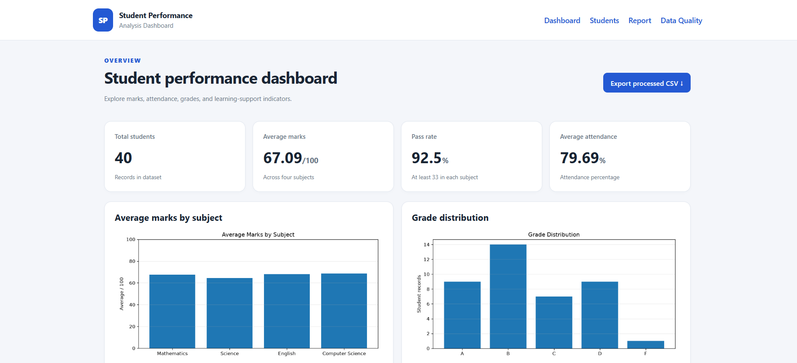
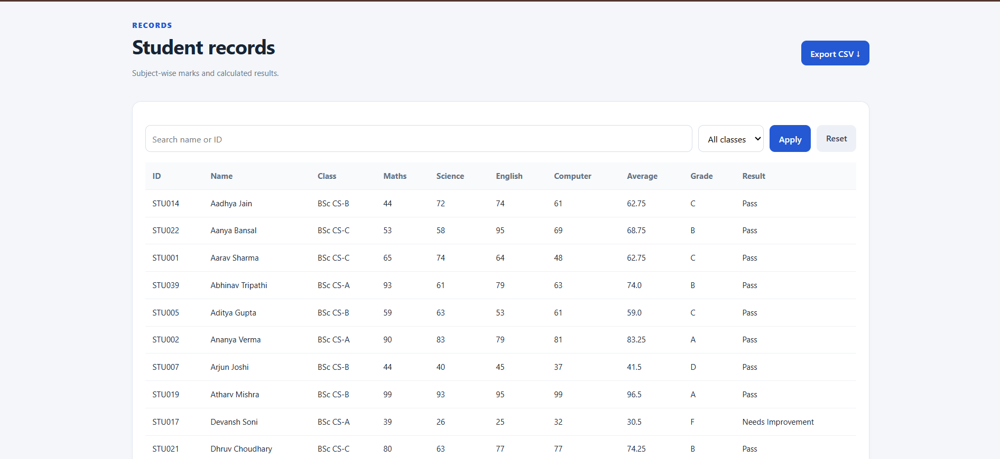
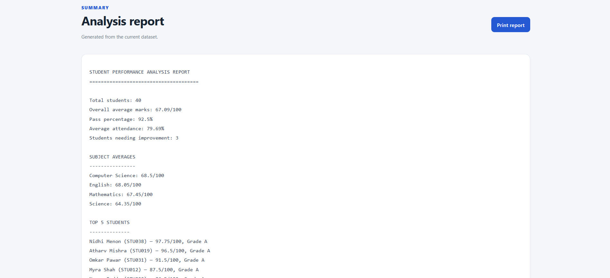
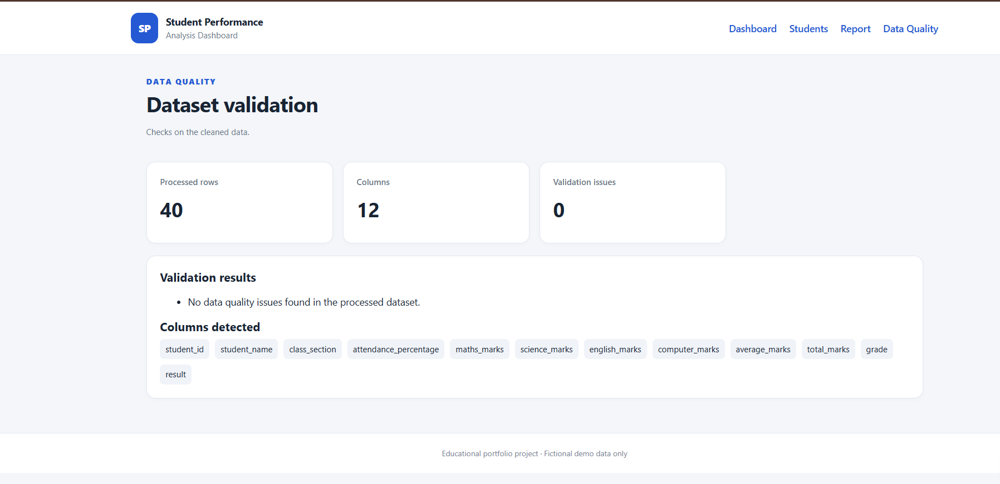

# Student Performance Analysis

A Python data-analysis and web-dashboard project that explores student marks, attendance, grade distribution, and subject-wise performance using a fictional CSV dataset. Built as a beginner-to-intermediate BSc Computer Science portfolio project.

## Features

- Load and clean CSV data using Pandas
- Handle missing or invalid numeric values using median filling and range checks
- Calculate total marks, average marks, grades, and pass/support status
- Interactive dashboard with KPI cards and Matplotlib charts
- Search student records by name or ID
- Filter records by class and section
- View student records and subject-wise marks
- Export processed records to CSV
- Generate a text-based analysis report
- Validate missing fields, duplicate IDs, and invalid ranges
- Responsive HTML/CSS interface
- Reusable analysis functions and automated tests

## Screenshots

### Dashboard



### Student Records



### Analysis Report



### Data Quality Validation



## Tech Stack

- Python 3.10+
- Flask
- Pandas
- Matplotlib
- HTML and CSS
- pytest

## Run on Windows

1. Install Python 3.10 or newer from [python.org](https://www.python.org/downloads/). Enable **Add Python to PATH** during installation.
2. Extract the project folder.
3. Double-click `run_windows.bat` and wait for dependency installation.
4. Double-click `start_windows.bat`.
5. Open [http://127.0.0.1:5000](http://127.0.0.1:5000).
6. Stop the local server by pressing `Ctrl+C` in the terminal.

## Manual Setup

Open a terminal in the project directory and run:

```bash
py -m venv .venv
.venv\Scripts\activate
py -m pip install -r requirements.txt
py app.py
```

## Run Tests

With dependencies installed, run:

```bash
py -m pytest -q
```

## Dataset and Grading Rules

The included CSV contains fictional sample records.

The example grading rules are:

- A: 80 and above
- B: 65 to below 80
- C: 50 to below 65
- D: 35 to below 50
- F: below 35

A student is marked **Pass** only if each subject score is at least 33. These are configurable examples, not any institution's official grading rules.

## Limitations

This is a local educational project, not a production student-information system. It has no login, authorization, database persistence, or production deployment hardening.

Use fictional data only. Performance indicators should not be treated as definitive judgments about individual students.

## Future Improvements

- Add CSV upload with schema validation
- Add SQLite persistence and authentication
- Add configurable grading rules and PDF report export
- Add Docker and GitHub Actions CI
- Deploy with environment-based configuration

## License

MIT. See [LICENSE](LICENSE).
